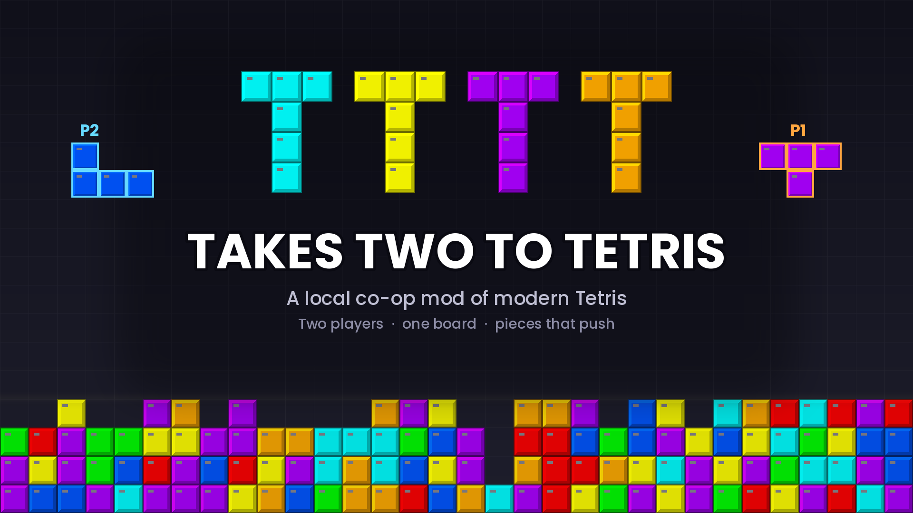
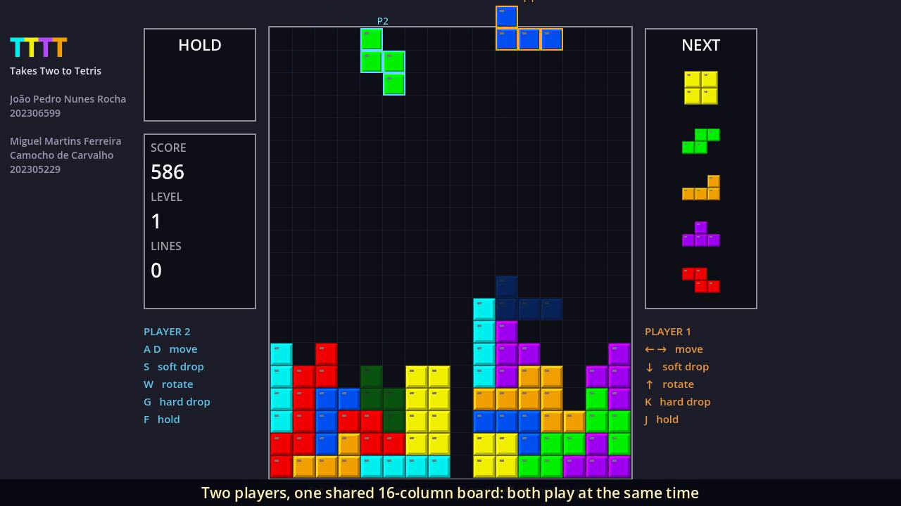
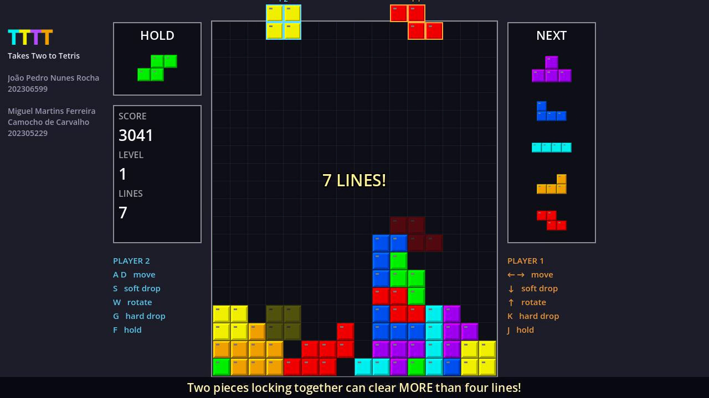
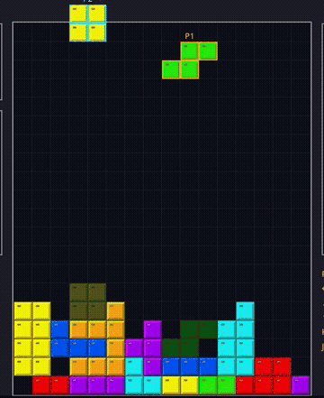

<p align="center">
  
</p>

<p align="center">
  <b>A local co-op mod of modern Tetris.</b><br>
  Two players, one board, and falling pieces that get in each other's way.
</p>

<p align="center">
  <a href="https://miguel-c05.itch.io/takes-two-to-tetris"><b>▶ Play in the browser (itch.io)</b></a>
  &nbsp;·&nbsp;
  <a href="https://www.youtube.com/watch?v=cC1sQapefLA"><b>Watch the gameplay video</b></a>
</p>

<p align="center">
  
  
  
</p>

---

## About

**TTTT (Takes Two to Tetris)** started as a question: what happens if two people have to share the same Tetris well?

Both players drop pieces at the same time on one 16-column board. They draw from the same Next queue, share a single Hold slot and a single score, and win or lose together. Falling pieces are solid, so they bump into each other in mid-air. Dropping onto your partner's piece pushes it down with yours. If both pieces land together, you can clear **more than four lines at once**.

Made for the *Modding a Classic Game* project of **Digital Games 2026/27**.

<p align="center">
  
  
</p>

## What's different from Tetris

| | Original (Guideline Tetris) | TTTT |
|---|---|---|
| Players | 1 | 2, at the same time |
| Board | 10 columns | 16 columns |
| Next queue | yours | shared: whoever locks takes the next piece |
| Hold | yours | one slot and one cooldown for both |
| Falling pieces | only one | solid to each other, they collide in mid-air |
| Soft / hard drop | moves your piece | also pushes your partner's piece down |
| Line clears | up to 4 (Tetris) | up to 8 when two pieces lock together |
| Score & game over | yours | shared |

Everything else is modern Tetris: 7-bag randomizer, SRS rotation with wall kicks, ghost piece, lock delay, T-spins, back-to-back and combos.

<p align="center">
  <br>
  <sub>Soft drop pushes your partner's piece down with you.</sub>
</p>

## Controls

| | Move | Soft drop | Rotate | Hard drop | Hold |
|---|:---:|:---:|:---:|:---:|:---:|
| **Player 1** | ← → | ↓ | ↑ | K | J |
| **Player 2** | A D | S | W | G | F |

`Esc` pause · `R` restart · on the game over screen, `Esc` goes back to the start menu.

On the **start menu**, pick the starting level (1 to 15) with ← → or A D and press `Enter`.

## Running it

**In the browser:** open the [itch.io page](https://miguel-c05.itch.io/takes-two-to-tetris), click the game once so it gets keyboard focus, and grab a friend.

**From source:** install [Godot 4.7](https://godotengine.org/), open Godot, choose *Import*, select `project.godot` and press `F5`.

## How it's built

```
Main (game.gd)        shared rules
├── Board (board.gd)  the grid and its rendering
├── Player1 / Player2 (player.gd)
├── HUD (hud.gd)
└── StartMenu (start_menu.gd)
```

| Script | What it does |
|---|---|
| `game.gd` | Everything both players share: board, queue, hold, gravity, collisions between pieces and pushing |
| `player.gd` | One per player: input, movement timing (DAS/ARR), soft drop, lock delay, T-spin detection |
| `board.gd` | Locked blocks, checks if cells are free, draws the board |
| `scoring.gd` | Points, combos, back-to-back and levels |
| `piece.gd` / `piece_data.gd` | A falling piece, plus the shapes and SRS kick tables |
| `bag_randomizer.gd` | 7-bag randomizer (seedable) |
| `hud.gd` / `start_menu.gd` | Interface and start screen |

A few decisions that make the co-op work:

- **One collision rule.** Every move, rotation and spawn asks the game if the cells are free on the board *and* not taken by the other player's piece.
- **Pushing as a group.** When a drop is blocked by the partner's piece, both pieces move down together. A hard drop locks both of them.
- **No mid-air locking.** A piece resting on a piece that is still falling keeps falling.
- **Lines are checked after both pieces lock.** That's what makes 5+ line clears possible.
- **The game decides the update order.** Players don't run their own `_process`, so the result never depends on which node Godot updates first.

## Team

| Name | Student number |
|---|---|
| João Pedro Nunes Rocha | 202306599 |
| Miguel Martins Ferreira Camocho de Carvalho | 202305229 |
